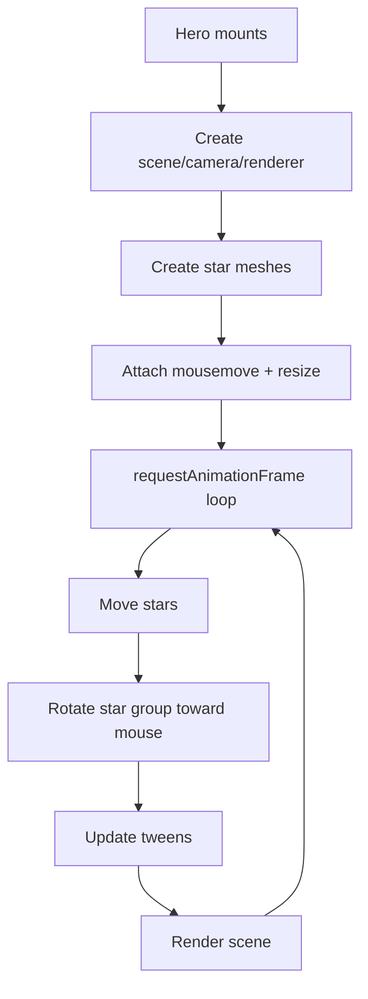

# Animations

The application uses several animation systems: Framer Motion, Three.js, React Three Fiber, CSS keyframes, canvas drawing, intersection observers, and parallax/tilt utilities.

## Framer Motion

Framer Motion is the most common UI animation library in the app.

### Scroll Reveal Cards

Used in:

- `components/Feature/Feature.jsx`
- `sections/About.jsx`
- `sections/Projects.jsx`
- `components/SkillCard/SkillsCard.jsx`
- `components/AboutDetail/Education.jsx`
- `components/AboutDetail/WorkExperience.jsx`
- `components/ProjectDetail/ProjectCard.jsx`

Common pattern:

```jsx
<motion.div
  initial={{ opacity: 0, y: 30 }}
  whileInView={{ opacity: 1, y: 0 }}
  transition={{ duration: 0.5 }}
  viewport={{ once: true, amount: 0.3 }}
>
```

Some sections use variant objects such as `cardVariant` to keep opacity, scale, and y-axis transitions consistent.

### Hover And Tap Animations

Used in:

- `sections/About.jsx` for avatar hover scale/rotation.
- `components/AboutDetail/AboutHero.jsx` for the CTA button.
- `components/AboutDetail/TechStack.jsx` for tech-icon hover scaling.

### Continuous Motion

Used in:

- `components/SkillCard/SkillsCard.jsx` for wobbling selected skill cards.
- `components/AboutDetail/AboutHero.jsx` for floating technology icons.
- `components/AboutDetail/TechStack.jsx` for floating icons and rotating conic gradient.

## Three.js Hero Animation

`sections/Hero.jsx` manually creates a Three.js scene.

Main behavior:

- Creates a scene, perspective camera, and alpha WebGL renderer.
- Generates 250 small sphere meshes as stars.
- Assigns each star a velocity vector.
- Moves stars every animation frame and bounces them inside a bounded space.
- Rotates the star group toward the normalized mouse position.
- Spawns a shooting star every 5 seconds and animates it with `@tweenjs/tween.js`.
- Tweens camera position on mount.
- Handles resize by updating renderer size and camera aspect ratio.
- Disposes geometries, materials, renderer, interval, and frame on cleanup.



## React Three Fiber UFO Scene

`components/AboutDetail/Ufo.jsx` renders a declarative 3D scene with `Canvas`.

Scene elements:

- `Stars` background from Drei.
- Multiple `Sparkles` fields.
- Ambient and directional lights.
- `UFOModel`, loaded from `/assets/3d/ufo.glb` with `useGLTF`.
- `Comet`, animated with `useFrame`.
- `OrbitControls` with `autoRotate`, zoom disabled, and pan disabled.

Interaction:

- Users can rotate the scene through orbit controls.
- The UFO scene auto-rotates.
- The comet moves along trigonometric paths based on elapsed time.

## Parallax Effects

Implemented utilities:

- `components/ParallaxWrapper.jsx`
- `components/MotionParallax.jsx`

`ParallaxWrapper` uses Framer Motion's `useViewportScroll` and `useTransform` to map scroll position to vertical movement.

Current status:

- These utilities exist but no active page import was found.
- `Home.jsx` imports `ParallaxProvider` from `react-scroll-parallax` but does not render it.

## Tilt Interactions

The app uses `react-parallax-tilt` in:

- `sections/About.jsx`: Desktop profile image card tilt with glare.
- `components/SkillCard/SkillsCard.jsx`: Skill tiles scale and tilt.

On mobile, the about profile card avoids `Tilt` and renders a simpler static wrapper.

## Custom Mouse Interaction

`components/MagicMouse.jsx` renders a fixed full-window canvas.

Behavior:

- Tracks mouse position.
- Stores up to 25 recent points.
- Draws small translucent circles with decreasing alpha.
- Redraws via `requestAnimationFrame`.
- Resizes with the window.

Current limitation: The animation frame id is not stored and cancelled during cleanup.

## CSS Animations

CSS keyframes are used for glow and gradient effects.

Files:

- `src/index.css`
- `src/components/Feature/FeatureWithAnimation.css`
- `src/sections/Projects.css`
- `src/sections/Feature.css`
- `src/components/AboutDetail/AboutHero.css`

Notable animations:

- `borderGlow` in `index.css`.
- `anim` glow opacity pulse in project and feature CSS.
- `rotation` for gradient angle in the older `sections/Feature.css`.
- `gradientBG` in `AboutHero.css`.

Current limitation: `AboutHero.css` is not correctly imported by `AboutHero.jsx`.

## Animation Performance Notes

- Three.js and canvas animations run continuously while mounted.
- The UFO section loads a large GLB model from `public/assets/3d/ufo.glb`.
- Framer Motion `whileInView` reduces unnecessary entrance animations outside the viewport.
- `LazyProjectCard` delays image rendering until cards enter the viewport.
- No global reduced-motion handling is implemented for custom canvas/WebGL animations.

