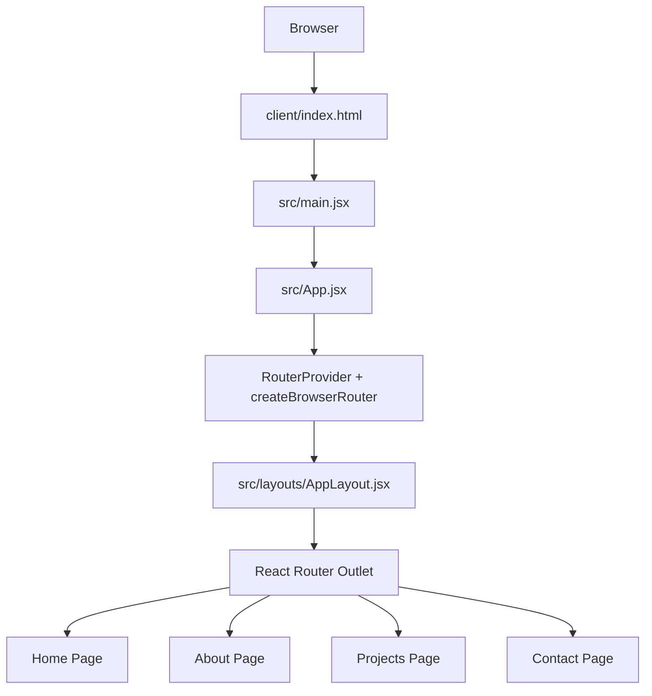
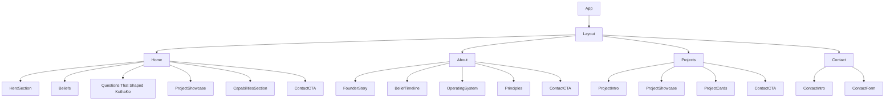
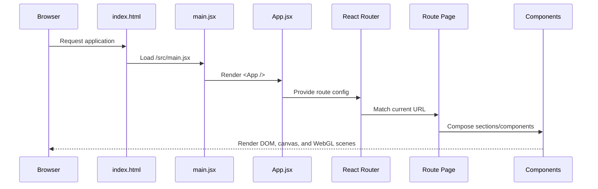
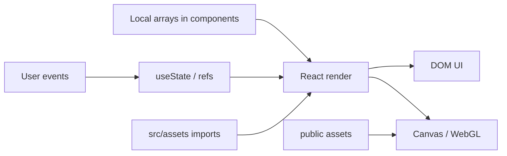

# Architecture

The project is a client-rendered React single-page application built with Vite. It has no visible backend, server routes, database layer, API client, state-management library, or SSR framework in the repository.

## Runtime Architecture

## Application Layers

- Entry layer: `client/index.html` and `src/main.jsx`.
- Routing layer: `src/App.jsx` and `src/layouts/AppLayout.jsx`.
- Page layer: `src/pages/*`.
- Section layer: `src/sections/*` and feature-specific page sections in `src/components/*`.
- Presentation layer: React components, Tailwind utility classes, CSS modules/files, icon components, motion wrappers, canvas, and WebGL scenes.
- Static asset layer: `src/assets` for bundled assets and `public` for root-served assets.

## Page And Component Hierarchy

## Rendering Flow

## Data Flow

The app currently uses local component state and local structured content arrays.

- Routing state is managed by `react-router-dom`.
- Theme preference state lives in the shared header/theme switcher flow.
- Contact form state lives in `pages/Contact.jsx` through `useState`.
- Founder, product, belief, capability, and decision-journal content lives in `data/portfolio.js`.
- Project data arrays live in `sections/Projects.jsx`, `ProjectDetail/ToursSection.jsx`, `ProjectDetail/GamingSection.jsx`, and `ProjectDetail/PortfolioSection.jsx`.
- Skills and tech-icon arrays live in `SkillCard/SkillsCard.jsx`, `sections/About.jsx`, `AboutDetail/AboutHero.jsx`, and `AboutDetail/TechStack.jsx`.
- Three.js scene state is held in refs and effect-local variables in `sections/Hero.jsx`.
- React Three Fiber scene state is handled by the Canvas render loop and refs in `AboutDetail/Ufo.jsx`.

## Styling Architecture

The app mixes Tailwind utility classes with global CSS and component CSS files:

- `src/index.css` defines the global font import, color variables, body styles, gradient text, glass cards, glow borders, and shared utility classes.
- `src/components/Feature/FeatureWithAnimation.css` defines glow-box and gradient helper classes for the active feature grid.
- `src/sections/Projects.css` defines project card glow borders.
- `src/sections/Feature.css` supports the older lazy feature-card implementation.
- `src/components/AboutDetail/AboutHero.css` defines a `gradientBG` keyframe, but the CSS file is not directly imported as CSS by `AboutHero.jsx`; the current import is `import "./AboutHero";`, which resolves the component file rather than the `.css` file.

## Build Architecture

Vite bundles `src` imports, processes React through `@vitejs/plugin-react`, and integrates Tailwind through `@tailwindcss/vite`. Assets in `public` are copied/served as root-level static files.
