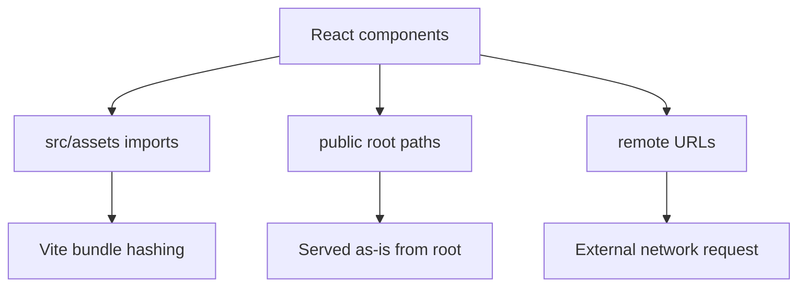

# Assets

The project uses a mix of bundled source assets, public static assets, and remote images.

## Public Assets

Public assets live in `client/public` and are served from the site root.

| Asset | Size | Current usage |
| --- | ---: | --- |
| `public/favic.svg` | 13.6 KB | Favicon referenced by `client/index.html` |
| `public/fav.svg` | 22.2 KB | No source reference found |
| `public/favi.svg` | 22.2 KB | No source reference found |
| `public/assets/3d/ufo.glb` | 25.2 MB | Loaded by `components/AboutDetail/Ufo.jsx` as `/assets/3d/ufo.glb` |
| `public/assets/3d/doraemon.glb` | 2.1 MB | No source reference found |
| `public/assets/screenshots/imgdesk1.png` | 128 KB | Existing root README screenshot |
| `public/assets/screenshots/imgdesk2.png` | 153 KB | Existing root README screenshot |
| `public/assets/screenshots/imgdesk3.png` | 574 KB | Existing root README screenshot |
| `public/assets/screenshots/imgdesk4.png` | 621 KB | Existing root README screenshot |
| `public/assets/screenshots/imgdesk5.png` | 150 KB | Existing root README screenshot |
| `public/assets/screenshots/imgmob1.png` - `imgmob11.png` | 18 KB - 124 KB each | Existing root README screenshots |
| `public/_redirects/index.html` | 0 B | Empty file; no active redirect content |

## Source Assets

Source assets live in `client/src/assets` and are bundled when imported.

| Asset | Size | Current usage |
| --- | ---: | --- |
| `src/assets/images/chatbot.jpeg` | 53 KB | Home projects and project detail sections |
| `src/assets/images/dash.jpeg` | 41 KB | Home projects and project detail sections |
| `src/assets/images/saas.jpeg` | 47 KB | Home projects and project detail sections |
| `src/assets/images/bgman.jpg` | 1.3 MB | No source reference found |
| `src/assets/images/bg-lady.jpg` | 2.4 MB | No source reference found |
| `src/assets/images/bg-flip.jpg` | 5.1 MB | No source reference found |
| `src/assets/images/flower-four-HqdVq5mo_EU-unsplash.jpg` | 1.8 MB | No source reference found |
| `src/assets/images/georgia-mashford-zu54Kdr6pI4-unsplash.jpg` | 3.6 MB | No source reference found |
| `src/assets/3d/doraemon.glb` | 2.1 MB | No source reference found |
| `src/assets/aibot.glb` | 659 KB | No source reference found |
| `src/assets/react.svg` | 4 KB | No source reference found |

## Remote Assets

Several images are loaded from remote URLs rather than local assets:

- GitHub avatar in `components/Header/Navbar.jsx`.
- GitHub avatar in `sections/About.jsx`.
- Raw GitHub decorative background, logo, and mail icon in `sections/About.jsx`.
- Unsplash image in `components/AboutDetail/AboutHero.jsx`.

These assets depend on external network availability and third-party URLs remaining stable.

## Missing Referenced Assets

The following path is referenced but was not found in the repository:

- `/Dipangkar_CV.pdf`, linked by `sections/Hero.jsx` and `components/SkillCard/SkillsCard.jsx`.

If the CV download should work in production, place the PDF at `client/public/Dipangkar_CV.pdf` or update the links to a valid hosted file.

## Asset Loading Model

## Recommendations

- Compress or remove unused large JPG files in `src/assets/images`.
- Avoid bundling unused GLB files.
- Consider Draco or meshopt compression for `ufo.glb`.
- Replace remote profile/decorative images with controlled local assets if long-term reliability matters.
- Add explicit alt text that describes content rather than generic labels where possible.

