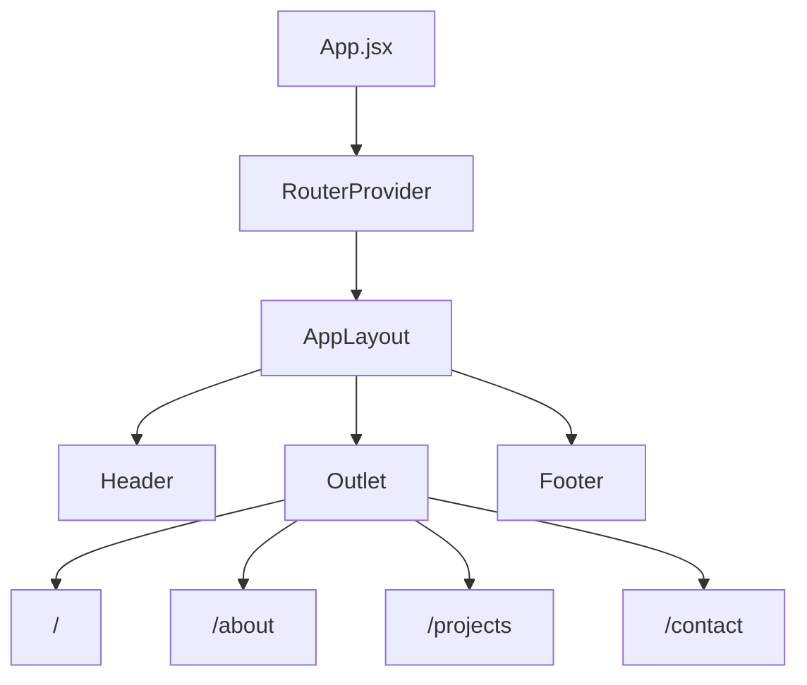

# Routing

Routing lives in `client/src/App.jsx` and uses `createBrowserRouter`.

## Canonical Routes

| Path | Page | Purpose |
| --- | --- | --- |
| `/` | `pages/Home.jsx` | Founder-first profile, beliefs, product work, and contact CTA |
| `/about` | `pages/About.jsx` | Founder narrative, product thesis, and principles |
| `/projects` | `pages/Projects.jsx` | KuthaKo flagship case study and related product systems |
| `/contact` | `pages/Contact.jsx` | Collaboration and communication-focused contact page |

## Legacy Redirects

The previous routes remain as redirects:

| Old path | Redirects to |
| --- | --- |
| `/aboutdetail` | `/about` |
| `/projectdetail` | `/projects` |
| `/contactdetail` | `/contact` |

Unknown routes redirect to `/`.

## Layout

All routes render inside `layouts/AppLayout.jsx`, which owns:

- fixed premium header
- route page transitions
- shared footer
- subtle page noise overlay

Pages are lazy-loaded with `React.lazy`, so each major route becomes a separate build chunk.

